# Skyward

English | [简体中文](README.zh-CN.md)

Skyward is a recovery written in Rust, from scratch.

<p align="center">
  
  
  
</p>

## Features

### Dual boot

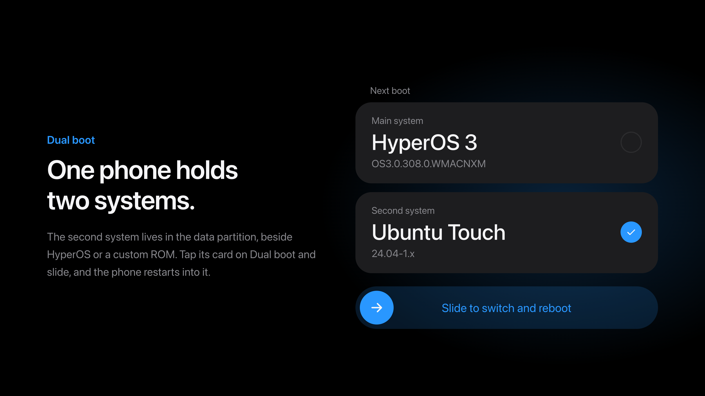

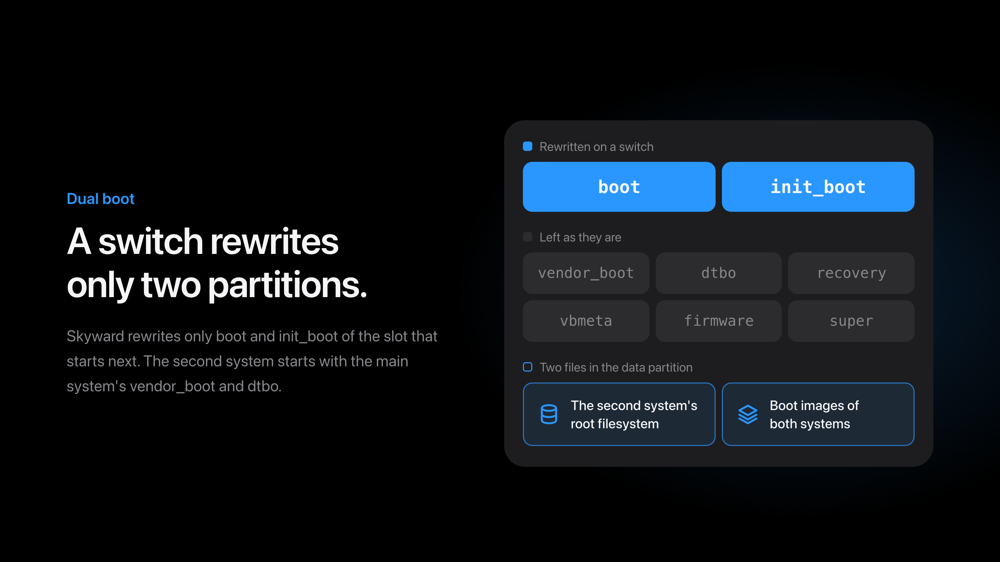

How a second system is packaged and started is in
[How dual boot works](#how-dual-boot-works).

### Decryption

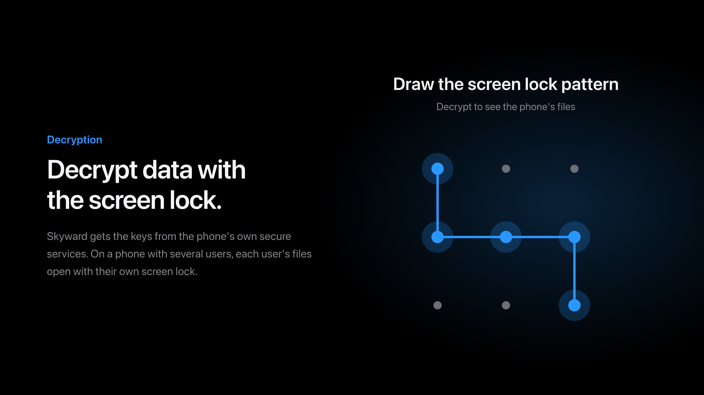

### Installing

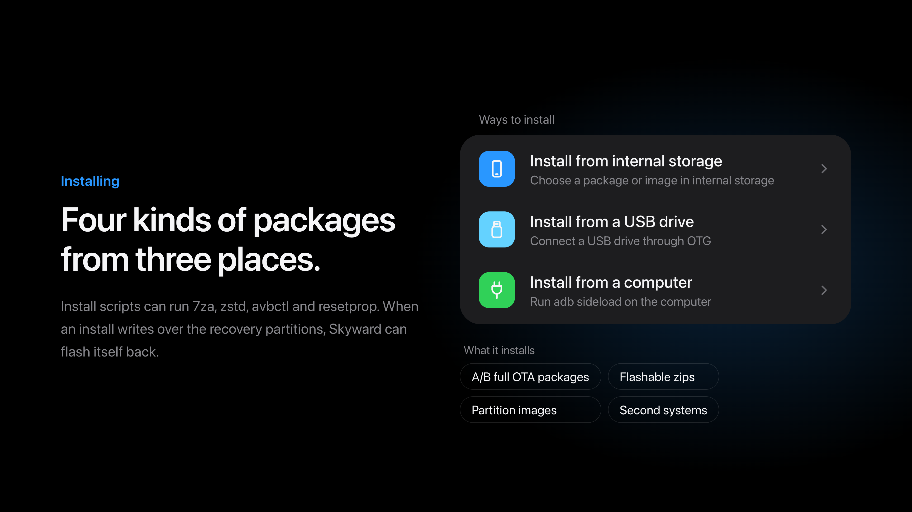

Install scripts get `7za` and `zstd`, which ROMs with a super image compressed by
zstd use to flash it, and an `unzip` whose `-p` streams the image as it reads it.
They also get `avbctl` and `resetprop`, to turn off verified boot's checks and to
read and set properties.

### Online updates

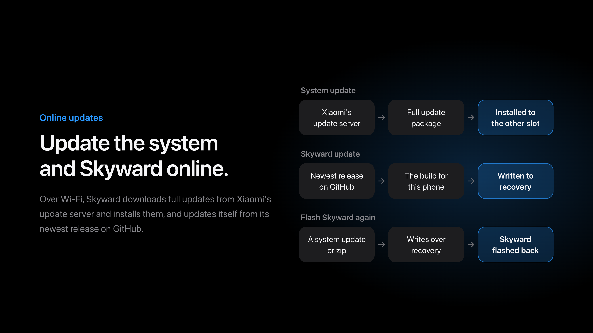

### Backup and restore

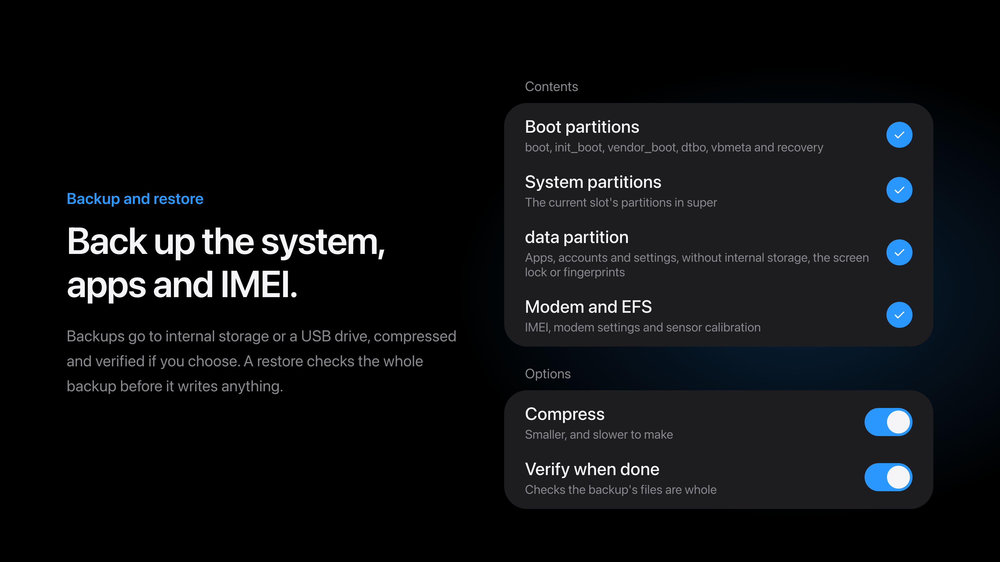

### File manager

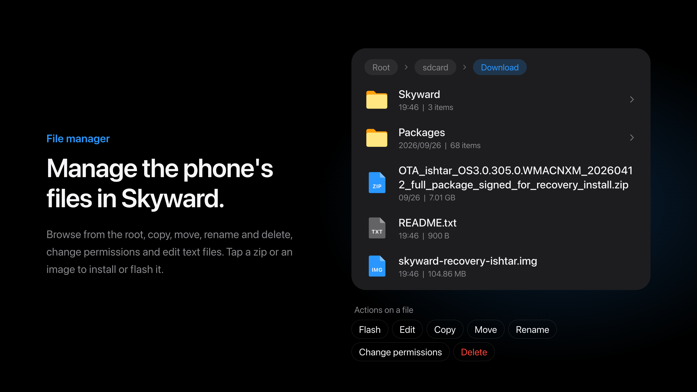

### Terminal

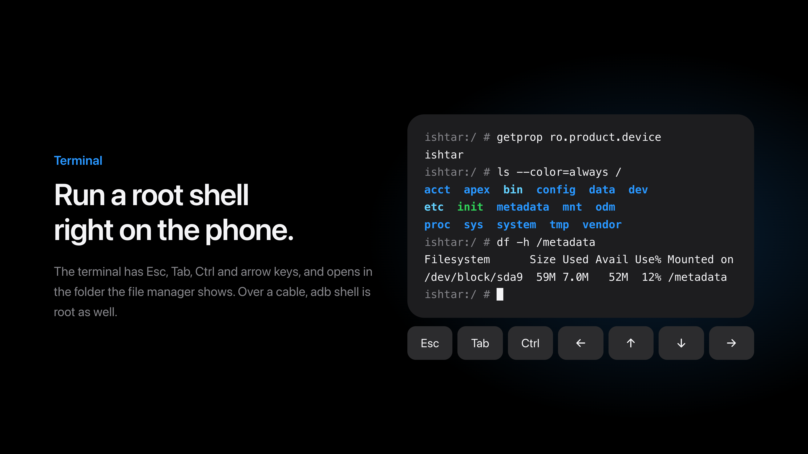

### Connecting a computer

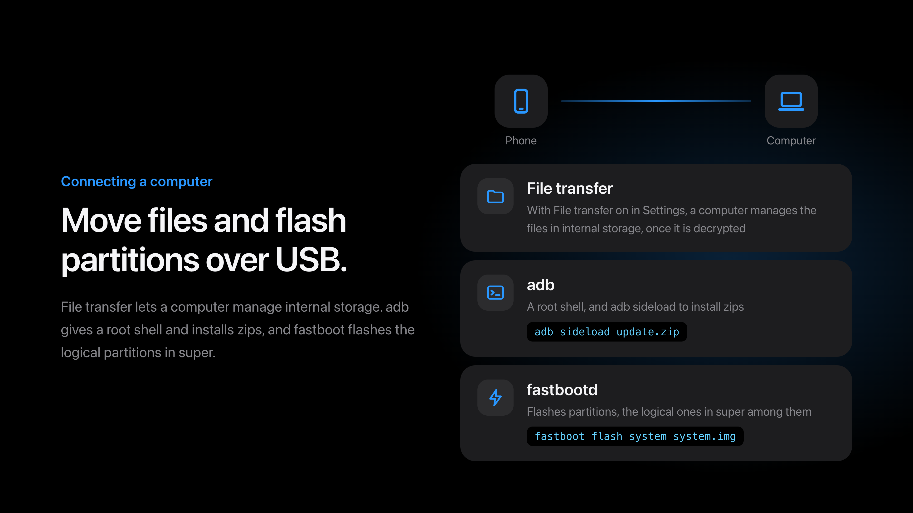

### Wiping data

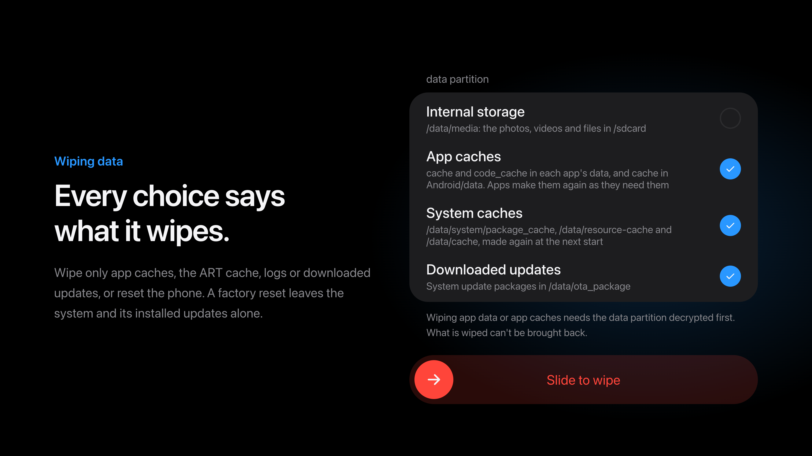

### Replacing the stock recovery

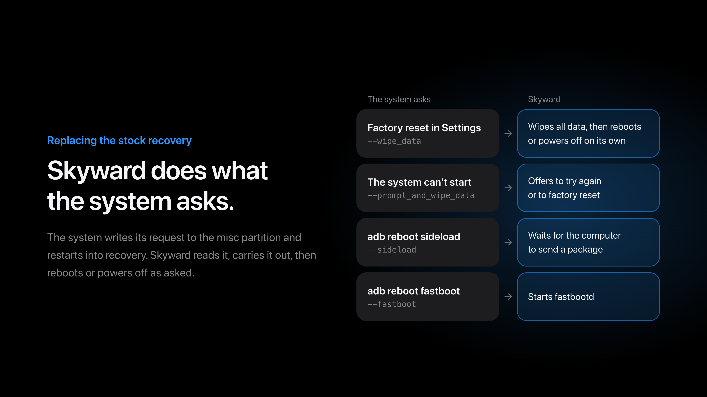

### Search

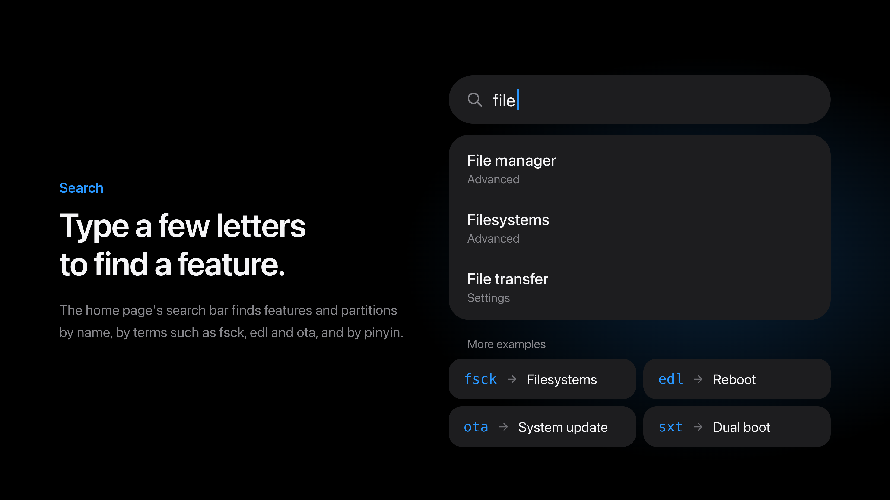

### Advanced

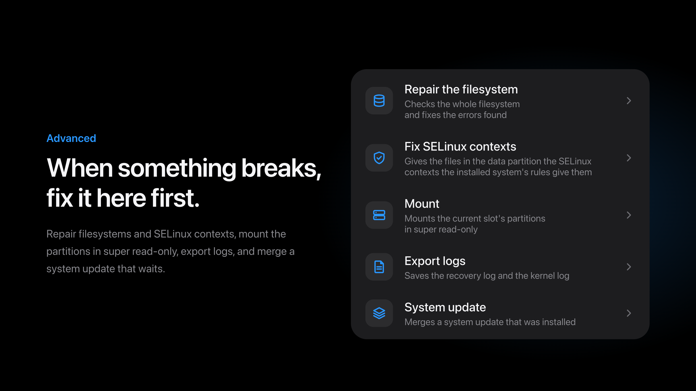

### About phone

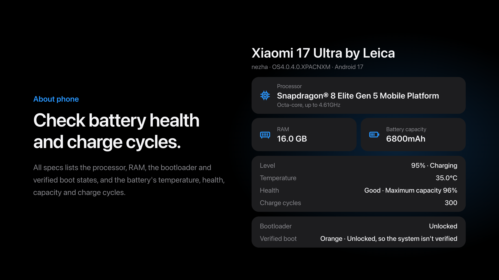

### Other features

- Reboot to system, recovery, fastboot, bootloader or EDL, and switch slots
- Light and dark themes; Simplified Chinese, Traditional Chinese and English

### Without a system

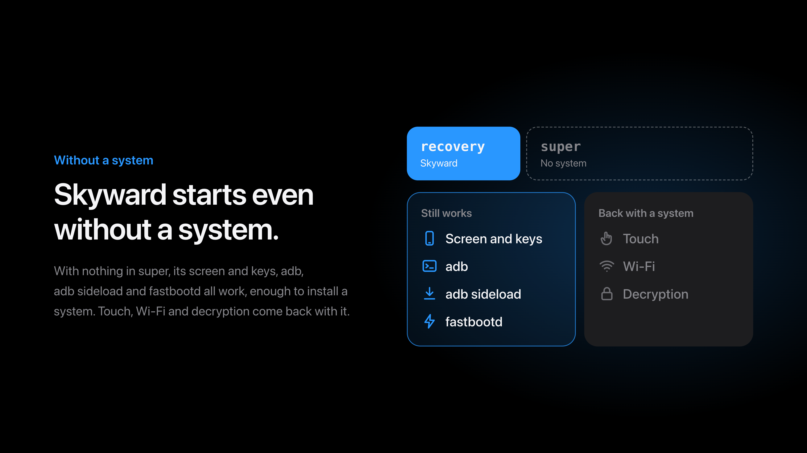

## Supported devices

| Device | Codename | Tested system version |
| --- | --- | --- |
| Xiaomi 17 Ultra | `nezha` | OS4.0.4.0.XPACNXM (Android 17) |
| Xiaomi 13 Ultra | `ishtar` | OS3.0.308.0.WMACNXM (Android 16) |

### 🚧 Under construction

These images are built from each phone's stock firmware and have not been tried
on the phone. They set up the screen, touch, Wi-Fi and vibration. The programs that
decrypting the data partition takes are read on the phone from the installed
system's own init scripts and service descriptions; what is read has been checked
against each model's stock firmware, and how those programs run on these models has
not been verified.

| Device | Codename | Built on |
| --- | --- | --- |
| 🚧 Xiaomi 13 | `fuxi` | OS3.0.309.0.WMCCNXM (Android 16) |
| 🚧 Xiaomi 13 Pro | `nuwa` | OS3.0.312.0.WMBCNXM (Android 16) |
| 🚧 Xiaomi 14 | `houji` | OS3.0.307.0.WNCCNXM (Android 16) |
| 🚧 Xiaomi 14 Pro | `shennong` | OS3.0.309.0.WNBCNXM (Android 16) |
| 🚧 Xiaomi 14 Ultra | `aurora` | OS3.0.308.0.WNACNXM (Android 16) |
| 🚧 Xiaomi 15 | `dada` | OS3.0.307.0.WOCCNXM (Android 16) |
| 🚧 Xiaomi 15 Pro | `haotian` | OS3.0.309.0.WOBCNXM (Android 16) |
| 🚧 Xiaomi 15 Ultra | `xuanyuan` | OS3.0.314.0.WOACNXM (Android 16) |
| 🚧 Xiaomi 17 | `pudding` | OS4.0.4.0.XPCCNXM (Android 17) |
| 🚧 Xiaomi 17 Pro | `pandora` | OS4.0.4.0.XBLCNXM (Android 17) |
| 🚧 Xiaomi 17 Pro Max | `popsicle` | OS4.0.4.0.XPBCNXM (Android 17) |
| 🚧 Xiaomi 17 Max | `byron` | OS3.0.310.0.WAFCNXM (Android 16) |
| 🚧 REDMI K80 | `zorn` | OS3.0.309.0.WOKCNXM (Android 16) |
| 🚧 REDMI K80 Pro | `miro` | OS3.0.305.0.WOMCNXM (Android 16) |
| 🚧 REDMI K90 | `annibale` | OS3.0.307.0.WPKCNXM (Android 16) |
| 🚧 REDMI K90 Pro Max | `myron` | OS4.0.4.0.XPMCNXM (Android 17) |
| 🚧 REDMI K90 Ultra | `warsaw` | OS3.0.309.0.WHPCNXM (Android 16) |
| 🚧 REDMI K100 Pro | `athens` | OS4.0.4.0.XPICNXM (Android 17) |
| 🚧 REDMI K100 Pro Max | `songyuan` | OS4.0.4.0.XGNCNXM (Android 17) |

## Installing Skyward

Skyward needs an unlocked bootloader. Download the zip for your phone from
[Releases](https://github.com/kirklin/skyward/releases), where each shows as the
phone's model and codename, such as Xiaomi 17 Ultra (nezha). Check it against
`SHA256SUMS`, unzip it, and flash the image inside to the recovery partition of
the slot the phone runs from, with the phone in fastboot mode:

```sh
unzip skyward-v0.3.1-nezha-OS4.0.4.0.XPACNXM.zip
fastboot flash recovery skyward-v0.3.1-nezha-OS4.0.4.0.XPACNXM.img
fastboot reboot recovery
```

Afterwards Skyward updates itself over Wi-Fi from its newest release, on the
Skyward update page in Settings; a newer image, unzipped, also installs from its own
Install page. With **Flash Skyward again** on, a system update or zip that writes
over the recovery partitions gets Skyward back in them.

adb in Skyward is a root shell that needs no authorization on the phone: anyone
with the phone and a cable can reach its storage while it is in recovery.

## How dual boot works

Skyward installs a second system beside the one in the phone's own partitions,
whether that is HyperOS or a custom ROM, and switches between them from **Dual boot**
on its home page. The second system's root is a file in the data partition that the
filesystem may neither move nor delete, read and written through the partition
itself; the boot images of both systems are kept in another such file. A switch
writes only the boot and init_boot partitions of the slot that starts next, and
keeps each step on /metadata first, so a switch cut off by a loss of power is
finished when Skyward next starts. vendor_boot, dtbo, recovery, vbmeta, the firmware
and super stay as they are, and the second system starts with the installed
system's vendor_boot and dtbo.

Before anything else writes the boot partitions, Skyward puts the installed system's
boot images back: an install, a slot switch, fastboot, a factory reset, and a backup
or restore of the boot partitions. The second system waits while a system update is
still to be merged, and backups of the data partition leave it out.

A second system installs from a zip on the Install page, as any other package does:

| File | What it holds |
| --- | --- |
| `system.toml` | `id`, `name`, `version` and `filesystem`; `init`, the program the root starts with, `/sbin/init` unless given; `minimum`, the least room the root takes, in bytes |
| `boot.img` | The kernel the bootloader starts |
| `rootfs.img` | The root filesystem's image, of the `filesystem` named |
| `init_boot.img` | Only for a system with a first ramdisk of its own |

A system without an init_boot image of its own starts from one Skyward makes. Its
program loads the installed system's first-stage kernel modules the way that
system's first stage loads them, with their soft dependencies and the settings the
kernel command line gives them, finds the root in the data partition, mounts it and
starts `init` there. If anything stops it, it brings Skyward up, as a failed start
of the installed system ends in the recovery: it leaves the reason in misc, unpacks
the ramdisk of the slot's recovery partition over its own, as the kernel unpacks it
when the bootloader starts the recovery, and hands over to Skyward's first program,
so Skyward comes up however the bootloader treats a restart. Skyward shows why, and
the second system still starts next until the user switches on Dual boot. A start
that stops moving restarts into the recovery instead, and a phone restarted before
the hand-over finds the same request in misc at its next start, which brings
Skyward up before anything else. Where Skyward comes up neither way, the phone stays
where it stopped, and never starts the same again and again. A system with a first
ramdisk of its own finds Skyward's program at `/skyward/map`, which lays the root
out as a block device and prints its node. Each switch to the second system writes
its init_boot image with the program of the Skyward that switches, so an updated
Skyward starts it with the new program.

A running system switches by writing `boot-recovery` with
`--switch_system=installed`, or `--switch_system=` and the second system's `id`, to
misc, and restarting into recovery. Where the bootloader starts the slot again, as
the 13 Ultra's can with a USB cable in, Skyward's program finds the request in misc
at the next start and brings Skyward up before anything else.

## Building

Skyward builds with the version of Rust that `rust-toolchain.toml` names, with its
`aarch64-linux-android` target, the Android NDK r29 and
[cargo-ndk](https://github.com/bbqsrc/cargo-ndk). The recovery service is built for
the phone, and the packer for the computer:

```sh
cargo ndk -t arm64-v8a --platform 30 build --release -p skyward
cargo build --release -p skyward-pack
```

The second system's first program runs before any library is there to load, so it
is built as a static program:

```sh
RUSTFLAGS="-C target-feature=+crt-static" cargo ndk -t arm64-v8a --platform 30 build --release -p skyward-system-init --target-dir target/system-init
```

The packer takes the stock recovery partition out of the build's full update
package on Xiaomi's server, reading only the part of the package the partition is
in, and checks its SHA-256 against the device file:

```sh
target/release/skyward-pack stock --config devices/nezha.toml --out target/stock/nezha/recovery.img
```

Then it builds the image on top of it:

```sh
target/release/skyward-pack recovery \
  --stock target/stock/nezha/recovery.img \
  --binary target/aarch64-linux-android/release/skyward \
  --system-init target/system-init/aarch64-linux-android/release/system-init \
  --config devices/nezha.toml \
  --font resources/fonts/MiSansVF.ttf \
  --mono resources/fonts/KirkMono-Regular.ttf \
  --mono-license resources/fonts/KirkMono-OFL.txt \
  --out target/skyward-nezha.img
```

Tests and lints run on the computer; what runs only on the phone is linted for it:

```sh
cargo test --workspace
cargo clippy --workspace --all-targets -- -D warnings
cargo ndk -t arm64-v8a --platform 30 clippy --workspace --all-targets -- -D warnings
```

The tests whose names start with `on_the_phone` make filesystems, mount them and
set encryption keys, which only a phone does. With a phone in Skyward attached over
adb, its data partition open, `cargo ndk` pushes each test program to the phone and
runs it there, one test at a time:

```sh
cargo ndk -t arm64-v8a --platform 30 test -p skyward -p skyward-block -p skyward-files -p skyward-mtp on_the_phone -- --test-threads=1
```

`skyward-preview` draws the pages on the computer, as PNG files, without a phone:
each page whole, as a long screenshot shows it, in the states it can be in, and the
screen at moments of touches and motion. `--lang` picks the language by a locale
such as `en` or `zh-TW`:

```sh
cargo run --release -p skyward-preview -- target/preview --lang en
```

## License

[GPL-3.0-or-later](LICENSE)
